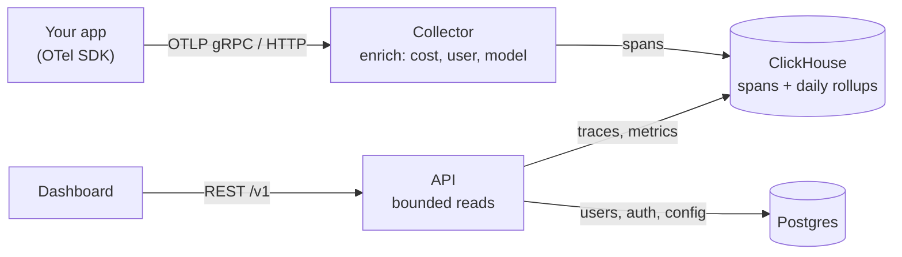

# Contributing to Tracium

Thanks for helping. Tracium is Apache 2.0 licensed.

This guide covers how the project is built and the reference details for running
and configuring it. The [README](README.md) is the short version.

## Architecture



The collector is a generic OpenTelemetry Collector distribution plus two Tracium
components; all domain logic sits behind an `enrich.Enricher` seam. **Storage split:** ClickHouse
holds span/trace data (time-partitioned, daily rollup so query cost tracks the
window, not total rows); Postgres holds config and accounts.

## Repo layout

| Directory | Language | Responsibility |
|---|---|---|
| [`collector/`](collector/) | Go | Receive OTLP, enrich, write to ClickHouse (see [ARCHITECTURE.md](collector/ARCHITECTURE.md)) |
| [`api/`](api/) | Go | Serve trace/metric data to the dashboard (REST) |
| [`dashboard/`](dashboard/) | React + TS | Trace viewer UI |
| [`spec/`](spec/) | JSON/YAML | Source of truth for API contracts + schemas |
| [`deploy/`](deploy/) | YAML/Helm | Helm chart, migration runner, infra config |

Each has a `README.md` documenting its conventions. Read the relevant one before
changing that component. To build your own application on top of the API and
dashboard packages, see [docs/extending.md](docs/extending.md).

## Build & test

```bash
make test            # go tests (collector, api) + dashboard tests
make smoke           # isolated end-to-end Docker check (Python 3 required)
make up              # run the full stack from source
make build-collector # assemble the collector via OCB
```

`make up` is `docker compose -f docker-compose.yml -f compose.build.yaml -f compose.dev.yaml up --build`, which also publishes ClickHouse on 127.0.0.1:8123 and Postgres on 127.0.0.1:5432.
Plain `docker compose up` pulls the release images (amd64 and arm64) pinned by
`TRACIUM_VERSION` in `.env` instead. Either way, schema migrations run
automatically before the app services start.

The Go modules are wired with `go.work`, so cross-module builds resolve locally
with no version pins.

### Services

| Service | URL / port | Purpose |
|---|---|---|
| Dashboard | http://localhost:3000 | Trace viewer + overview UI |
| API | http://localhost:8090 | REST API (`/v1/...`) the dashboard reads |
| Collector (OTLP gRPC) | `localhost:4317` | Point your app's OTLP exporter here |
| Collector (OTLP HTTP) | `localhost:4318` | Same, HTTP/protobuf |
| Collector (health) | http://localhost:13133/ | Liveness / readiness |

### Demo data

With the stack up, seed a demo account, workspaces, and ~1,500 realistic traces
(Node.js 18+):

```bash
cd dashboard && npm run seed
```

Then sign in at http://localhost:3000 with `demo@tracium.ai` / `tracium-demo-1234`.
See [dashboard/README.md](dashboard/README.md#seed-demo-data) for options.

### Examples

Runnable senders are in [`examples/`](examples/); each needs `TRACIUM_API_KEY`:

| Example | What it sends |
|---|---|
| [`node/genai-span.mjs`](examples/node/genai-span.mjs) | A two-call workflow with hand-set GenAI attributes; no LLM key needed |
| [`openai_to_tracium.py`](examples/openai_to_tracium.py) | A multi-step OpenAI agent with tool calls, via OpenLLMetry |
| [`failed_span_to_tracium.py`](examples/failed_span_to_tracium.py) | A batch job whose last OpenAI call fails |

```bash
cd examples/node && npm install
TRACIUM_API_KEY=trc_... npm start
```

## Ground rules (from the design docs)

- **Program against interfaces**, wire concrete types in one place (`main.go` /
  provider setup).
- **Typed errors** from `internal/errors`, never bare `fmt.Errorf`/`new Error` out
  of a pipeline stage or repository.
- **`spec/` is the source of truth.** Change a shared type there first, then
  regenerate consumers; never hand-edit generated files.
- **Every read must be time- or trace-bounded.** Nothing may scan the span table
  unbounded; cost scales with the query window, not total rows stored.
- **Record user-visible changes** in [CHANGELOG.md](CHANGELOG.md).

## Pull requests

Keep PRs focused. Include tests (unit tests use mocks, never a real DB). CI runs
the affected component's tests and checks that generated code is in sync.

## Running Tracium: reference

### Ingest keys

Every OTLP request needs a workspace API key (`Authorization=Bearer trc_…`): a
request with no key, or an unknown or revoked one, is rejected with 401 and
nothing is stored. The key decides which workspace the telemetry lands in, so
senders set no workspace attribute. Keys are created on the workspace's **API
keys** screen or with `POST /v1/workspaces/{id}/api-keys`, and shown only once.
See [securing the collector](deploy/docs/collector-auth.md).

### Instrumentation

Tracium reads the [OpenTelemetry GenAI semantic conventions](https://opentelemetry.io/docs/specs/semconv/gen-ai/)
(`gen_ai.request.model`, `gen_ai.usage.input_tokens`, …) and the attributes
[OpenLLMetry](https://github.com/traceloop/openllmetry) emits. OpenLLMetry's
`workflow`/`task`/`agent`/`tool` decorators become Tracium workflows. For your own
spans, see [span setup](https://docs.tracium.ai/#otel-setup) for how runs, latency
and cached tokens are counted, and [`spec/attributes/genai.yaml`](spec/attributes/genai.yaml)
for the span attributes Tracium reads.

### Workflow versions

Set `tracium.workflow.version` on the resource to compare cost, latency, errors
and tokens between versions of a workflow (`GET /v1/metrics/workflows/{name}/versions`).
Any string works: a semver, a git sha, a prompt version. Keep it stable across
runs: a timestamp or request id makes every run its own version.

With any OTel SDK, through the environment:

```bash
OTEL_RESOURCE_ATTRIBUTES=tracium.workflow.version=v12
```

With OpenLLMetry:

```python
Traceloop.init(resource_attributes={"tracium.workflow.version": "v12"})
```

In code, with the plain OTel SDK:

```js
resourceFromAttributes({ "service.name": "support-bot", "tracium.workflow.version": "v12" })
```

Only the resource attribute is read: a span attribute of the same name, or any
other version attribute, is ignored. Runs without it are unversioned.

### Configuration

- **`JWT_SECRET` is required.** It signs and verifies auth tokens with one key, so
  generate a unique one per deployment (`openssl rand -hex 32`).
- **Network:** Compose binds published ports to `127.0.0.1`. The dashboard sends
  API requests to its own origin, so it works behind a reverse proxy without
  rebuilding the frontend.
- **Retention:** `RETENTION_DAYS` (default 90; `0` keeps data forever).
- **Cost allocation:** any custom OTLP attribute your apps attach (e.g. `team`,
  `user.id`, `environment`) is retained and becomes a dimension you can allocate
  spend by with `GET /v1/metrics/usage-by-attribute?key=team`, or the dashboard's
  cost-allocation picker.
- **Clients:** tag spans with `tracium.user.id` (span or resource attribute) to
  meter spend per end client. The dashboard's **Clients** page lists them, and
  each client's detail page breaks down its spend, runs, failure rate, latency,
  models, workflows and recent traces. It's a metering label, not an access
  boundary.
- **Prompt/completion capture is ON by default** so the viewer can show
  inputs/outputs; set `CAPTURE_CONTENT=false` in `.env` (Helm:
  `collector.captureContent=false`) if you don't want that text stored.

### Kubernetes

Helm chart in [`deploy/helm/tracium`](deploy/helm/tracium/); steps in
[`deploy/README.md`](deploy/README.md).

### Members and accounts

Workspace owners invite teammates by email from **Settings → Members** (or
`POST /v1/workspaces/{id}/invites`). Tracium doesn't send email: the owner gets a
single-use link (`/invite/<token>`, valid for 7 days) to share, and the invitee
accepts it after signing in or signing up with the invited address. Owners can
list and revoke open invites and remove members from the same screen.

Signed-in users change their password under **Settings → Account** (or
`POST /v1/auth/password`); there is no email-based reset, so an operator resets
a forgotten password with the API image's CLI:

```bash
docker compose exec api ./reset-password --email you@example.com
```

It prints a generated password unless you pass `--password`. Profile editing,
workspace editing, and retention controls in the UI are unavailable; the UI
labels these limitations. Configure retention in the deployment.

### Upgrades

Existing installations must follow [the upgrade guide](deploy/docs/upgrading.md)
before adopting workspace scoping. The migration preserves legacy aggregates and
requires an explicit destination workspace rather than guessing data ownership.

## Conduct and reporting

Participation is covered by the [Code of Conduct](CODE_OF_CONDUCT.md). Report
bugs and request features through the issue templates; report vulnerabilities
privately per [SECURITY.md](SECURITY.md).
