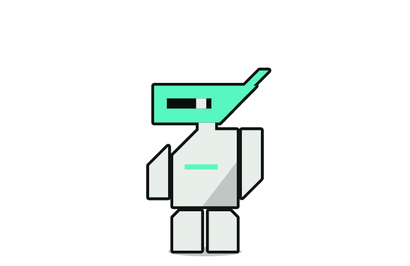
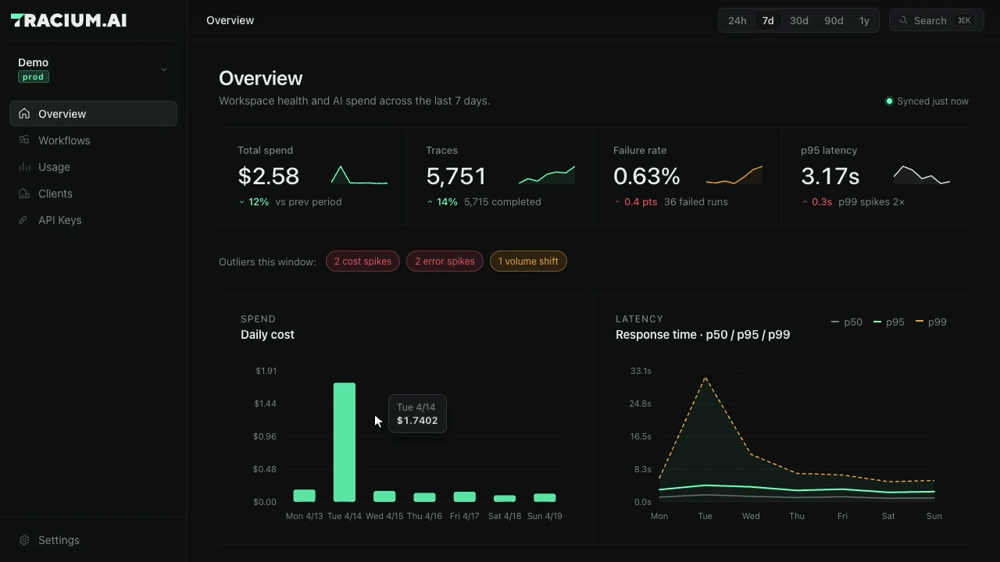
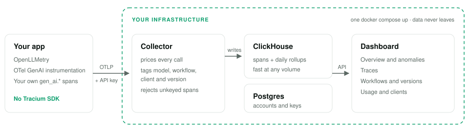
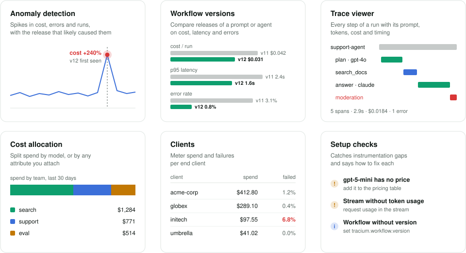

<p align="center">
  <picture>
    <source media="(prefers-color-scheme: dark)" srcset="docs/assets/tracium-robot-dark.png">
    
  </picture>
</p>

<h3 align="center">Open-source, self-hosted LLM observability</h3>

<p align="center">
  Know what every model call costs, how long it takes, and when it fails,<br>
  per model, workflow, and end client. Built on OpenTelemetry.
</p>

<p align="center">
  <a href="LICENSE"></a>
  <a href="https://github.com/antonij-simonovski/tracium/releases"></a>
  <a href="https://github.com/antonij-simonovski/tracium/stargazers"></a>
</p>

<p align="center">
  <a href="https://docs.tracium.ai">Docs</a> ·
  <a href="#quickstart">Quickstart</a> ·
  <a href="CONTRIBUTING.md">Contributing</a> ·
  <a href="CHANGELOG.md">Changelog</a>
</p>



## How it works

<picture>
  <source media="(prefers-color-scheme: dark)" srcset="docs/assets/tracium-how-it-works-dark.svg">
  
</picture>

Tracium is an OpenTelemetry backend, not an SDK: anything that exports OTLP can
send to it. It reads the [GenAI semantic conventions](https://opentelemetry.io/docs/specs/semconv/gen-ai/)
and [OpenLLMetry](https://github.com/traceloop/openllmetry) attributes, so OpenAI,
Anthropic, Bedrock, Vertex AI, LangChain, LlamaIndex and more work out of the box.

## Features

<picture>
  <source media="(prefers-color-scheme: dark)" srcset="docs/assets/tracium-features-dark.svg">
  
</picture>

## Quickstart

Requires Docker with Compose v2.

```bash
git clone https://github.com/antonij-simonovski/tracium && cd tracium
cp .env.example .env   # set JWT_SECRET, CLICKHOUSE_PASSWORD, POSTGRES_PASSWORD (openssl rand -hex 32)
docker compose up
```

Open http://localhost:3000, create a workspace and an API key, then point your app at Tracium:

```bash
OTEL_EXPORTER_OTLP_ENDPOINT=http://localhost:4318
OTEL_EXPORTER_OTLP_PROTOCOL=http/protobuf
OTEL_EXPORTER_OTLP_HEADERS="Authorization=Bearer YOUR_API_KEY"
```

No app yet? Run `cd dashboard && npm run seed` and sign in as `demo@tracium.ai` / `tracium-demo-1234`,
or try one of the [examples](examples/).

## Learn more

[Documentation](https://docs.tracium.ai) ·
[Configuration and development](CONTRIBUTING.md) ·
[Kubernetes](deploy/README.md) ·
[Upgrading](deploy/docs/upgrading.md) ·
[Security](SECURITY.md)

Apache 2.0. Contributions welcome, see [CONTRIBUTING.md](CONTRIBUTING.md).
